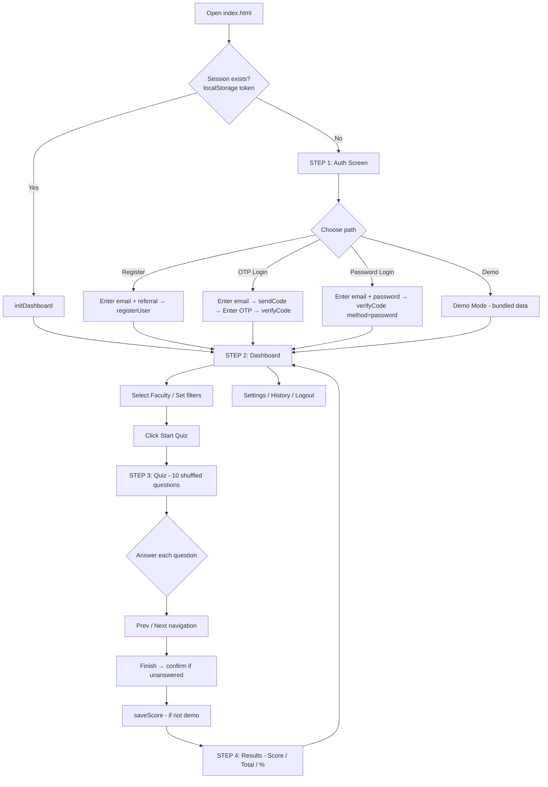

# Standard Operating Procedure (SOP)
## MCQ Master — CPREC Nepal
### User Workflow: Authentication → Dashboard → Quiz → Results

| Field | Detail |
|---|---|
| **System** | MCQ Master \| CPREC Nepal (`index.html`) |
| **Document Title** | SOP for End-User Workflow |
| **Version** | 1.0 |
| **Effective Date** | 27 November 2026 |
| **Owner** | CPREC Nepal |
| **Applies To** | Students, Faculty, and Administrators using the MCQ Master web application |
| **Backend** | Google Apps Script Web App (API endpoint in `index.html` → `const API`) |
| **Frontend** | Single-page application — `index.html` (HTML + Tailwind CSS + Vanilla JS) |

---

## 1. Purpose

This SOP defines the standard, step-by-step procedure for completing the core workflow in MCQ Master:

> **Authenticate → Configure Quiz → Attempt Quiz → View Results → Manage Profile**

It ensures consistent, error-free use by students and support staff, and provides a single reference for training, onboarding, and troubleshooting.

## 2. Scope

**In scope:**
- User registration, login (OTP & password), and demo access
- Dashboard navigation (Overview / Settings / History)
- Quiz setup with Faculty and Set filters
- Quiz attempt, navigation, scoring, and result submission
- Profile update, avatar upload, password change, and referral sharing
- Logout and session handling

**Out of scope:**
- Backend (Google Apps Script / Google Sheets) administration
- Question bank authoring and moderation
- Server hosting, deployment, and access control

## 3. Roles & Responsibilities

| Role | Responsibilities |
|---|---|
| **Student / User** | Register/login, attempt quizzes, maintain own profile, share referral code |
| **Faculty / Trainer** | Guide students through SOP; verify quiz results in History |
| **Administrator** | Maintain question bank via backend API; resolve access issues; manage demo vs. live data |

## 4. System Overview

```
┌──────────────┐    HTTPS GET (query params)    ┌─────────────────────────┐
│  index.html  │ ─────────────────────────────▶ │ Google Apps Script API  │
│  (Frontend)  │ ◀───────────────────────────── │ (doGet → JSON response) │
└──────┬───────┘                                └─────────────────────────┘
       │ localStorage: mcq_token, mcq_email
       ▼
┌──────────────┐
│  Browser     │  Demo fallback: bundled DEMO data (12 sample MCQs)
└──────────────┘
```

**Key facts:**
- No build step. Open `index.html` in any modern browser.
- Session persists via `localStorage` (`mcq_token`, `mcq_email`) until Logout.
- If the backend is unreachable, the app falls back to bundled demo questions and notifies the user via toast.
- All API calls are `GET` requests with query parameters (`type=...`).

### 4.1 API Reference (Backend Contract)

| `type` Parameter | Purpose | Key Parameters |
|---|---|---|
| `registerUser` | Create new account | `email`, `referralCode`, `ip` |
| `sendCode` | Send OTP to email | `email`, `ip` |
| `verifyCode` | Verify OTP **or** password login | `email`, `code`, `method=password` (optional) |
| `getProfile` | Fetch user profile | `email`, `token` |
| `getMCQs` | Fetch question bank | — |
| `getFilters` | Fetch Faculty / Set lists | — |
| `uploadAvatar` | Upload profile photo | `email`, `token`, `base64Data`, `mimeType` |
| `updateProfile` | Save profile / password | `email`, `token`, `fullName`, `phone`, `college`, `newPassword` |
| `saveScore` | Persist quiz result | `email`, `subject`, `college`, `score`, `total`, `percentage` |

---

## 5. Prerequisites

1. Modern browser (Chrome / Edge / Firefox / Safari) with JavaScript enabled.
2. Internet connection (required for live login and question loading; demo mode works offline after page load).
3. Valid email address for registration / OTP login.
4. (Optional) Referral code from an existing user for registration credit.

---

## 6. Workflow Overview



**Screen / Step Map (in code):**

| Step ID | Section ID | Description |
|---|---|---|
| Step 1 | `step-auth` | Login / Register / Demo |
| Step 2 | `step-dashboard` | Overview, Settings, History panels |
| Step 3 | `step-quiz` | Question-by-question attempt |
| Step 4 | `step-results` | Final score display |

---

## 7. Detailed Procedures

### SOP-01 — User Registration

**When:** A new user needs an account.

1. On the Auth screen, click **“New user? Register”** (`btn-toggle-mode`).
   - Referral field appears; mode switches to `register`; method resets to OTP.
2. Enter a valid **email** in `auth-email`.
3. (Optional) Enter **Referral Code** in `auth-referral` — the code of the user who invited you.
4. Click **“Request Access”** (`btn-auth-action`).
5. System calls `registerUser` with `email`, `referralCode`, `ip=web`.
6. Observe toast:
   - ✅ Success → proceed to login (OTP or password as instructed by backend message).
   - ❌ Error → correct email / check referral code and retry.
7. Log in using SOP-02 or SOP-03.

> **Note:** Registration does not auto-login. Always complete a login step after registering.

---

### SOP-02 — Login via OTP (Email Code)

**When:** Default login method. No password required.

1. Ensure mode is **Login** and method is **OTP** (button reads “Continue with Email”).
   - If not, click **“Login with Password”** toggle to switch back to OTP.
2. Enter **email** → click **“Continue with Email”**.
3. System calls `sendCode`. On success:
   - OTP modal (`modal-back`) opens.
   - Toast: “Code sent to your email”.
4. Enter the **6-digit code** in `input-otp` → click **Verify** (`btn-verify-otp`).
5. System calls `verifyCode` with `email` + `code`.
6. On success:
   - Token saved to `localStorage` (`mcq_token`, `mcq_email`).
   - `initDashboard()` loads profile + questions.
   - Toast: “Welcome back!”
7. On failure: toast shows backend message (e.g., expired/invalid code). Re-request a new code from Step 2.

---

### SOP-03 — Login via Password

**When:** User has an existing password set via Profile Settings.

1. On Auth screen, click **“Login with Password”** (`btn-toggle-method`).
   - Password field (`auth-password-group`) appears; button text changes to “Login”.
2. Enter **email** and **password**.
3. Click **Login**.
4. System calls `verifyCode` with `method=password`.
5. On success: token stored, dashboard loads (same as SOP-02, Step 6).
6. On failure: toast shows error. Verify password or switch to OTP login.

---

### SOP-04 — Demo Mode (No Account Required)

**When:** Training, evaluation, or backend is unavailable.

1. On Auth screen, click **“Try Demo Mode”** (`btn-demo`).
2. System sets `state.demo = true`, loads bundled `DEMO` profile and 12 sample MCQs (Pharmacy / Nursing / Public Health / Biology).
3. Dashboard loads immediately; toast: “Demo mode — sample questions loaded”.
4. **Important:** In demo mode:
   - No backend calls are made for profile/questions.
   - Scores are **not** saved (`saveScore` is skipped).
   - Use only for practice and demonstration.

---

### SOP-05 — Dashboard Navigation

After successful login, the Dashboard (`step-dashboard`) is displayed.

1. **Sidebar panels** (click to switch):
   - **Dashboard / Overview** (`panel-overview`) — Stats: Quizzes taken, Average Score, Referrals.
   - **Settings** (`panel-settings`) — Profile & referral management (SOP-09, SOP-10).
   - **History** (`panel-history`) — Past attempts (SOP-11).
2. **Header:** User badge (avatar + name) — click to jump to Settings. Theme toggle (dark/light) at top-right.
3. **Quiz Setup** section is always visible in the sidebar (SOP-06).

---

### SOP-06 — Quiz Setup & Filtering

**When:** Preparing to start a quiz.

1. In the sidebar **Quiz Setup** section:
   - **Faculty** (`filter-faculty`) — Select a subject (e.g., Pharmacy, Nursing) or leave “All Faculties”.
   - **Set** (`filter-level`) — Select a level/set (e.g., Set 1, Set 2) or leave “All Sets”.
2. Filters are populated from:
   - Live backend via `getFilters`, **or**
   - Derived locally from loaded questions (`populateFilters()`) if backend is unavailable.
3. If a filter is active, **Reset** button appears — click to clear both filters.
4. Click **Start Quiz** (`btn-start-quiz`).
   - System filters questions, applies **Fisher-Yates shuffle**, and selects up to **10 questions**.
   - If no questions match: toast “No questions found” — change filters and retry.

> **Rule:** The Set filter is only applied when questions actually carry a `level` field, to avoid breaking the live backend flow.

---

### SOP-07 — Taking a Quiz

**Screen:** `step-quiz`

1. **Question display:** Counter (“Question X of Y”), progress bar, and “X/Y answered” indicator.
2. **Answering:**
   - Click an option card (A / B / C / D).
   - Correct answer turns **green**; wrong selection turns **red** with correct answer highlighted.
   - Answer is locked for that question (cannot change after selection).
   - Score increments immediately if correct.
3. **Navigation:**
   - **Prev** — Go to previous question (disabled on Question 1).
   - **Next** — Go to next question. Enabled only after answering current question; disabled on last question.
   - **Finish** — End quiz at any time (see SOP-08).
4. Repeat until all questions are answered or you choose to finish early.

---

### SOP-08 — Finishing & Viewing Results

1. Click **Finish** (`btn-q-finish`).
2. If not all questions answered:
   - Confirmation dialog: “You've answered X of Y questions. Finish anyway?”
   - Click **OK** to submit, **Cancel** to continue.
3. System calculates: `Score`, `Total`, `Percentage = (Score/Total) × 100`.
4. If **not** in demo mode: calls `saveScore` with email, subject (selected Faculty or “General”), score, total, percentage.
5. **Results screen** (`step-results`) displays: `Score/Total (Percentage%)`.
6. Click **“Back to Dashboard”** to return to Overview and start another quiz.

---

### SOP-09 — Profile & Settings Update

**Screen:** `panel-settings`

1. Click **Settings** in sidebar (or user badge in header).
2. **Avatar:**
   - Click camera icon → select image file (`avatar-upload`).
   - File is read as Base64 and sent via `uploadAvatar`.
   - On success: avatar updates in header and settings; toast “Photo updated!”.
3. **Edit fields:**
   - Full Name (`settings-name`)
   - Phone (`settings-phone`, e.g., +977...)
   - College/Organization (`settings-college`)
   - Email (`settings-email`) — **read-only**, cannot be changed here.
4. **Password (optional):** Enter new password in `pass-new` to set/change it.
5. Click **Save Changes** (`btn-save-profile`).
   - System calls `updateProfile`.
   - On success: UI refreshes, password field clears, toast “Profile saved!”.
   - On failure: toast shows error; correct and retry.

---

### SOP-10 — Referral Code Sharing

1. In Settings, scroll to **Referral Section**.
2. Your code is shown in `referral-code-display`.
3. Click **Copy** icon (`copyReferral()`) — code copied to clipboard; toast “Code copied!”.
4. Share the code with friends. When they register with your code (SOP-01), you earn referral credit (tracked in Overview → Referrals).

---

### SOP-11 — History Review

1. Click **History** in sidebar.
2. Panel (`panel-history`) lists past quiz attempts (loaded from backend profile/history data).
3. If empty: “No history found.”
4. Use History to review performance before attempting new quizzes.

---

### SOP-12 — Logout & Session Management

1. Click **Logout** (`btn-logout`) in sidebar.
2. System clears `localStorage` and reloads the page (`location.reload()`).
3. User returns to Auth screen; token is removed.
4. **Auto-login:** On page load, if `mcq_token` + `mcq_email` exist in `localStorage`, the app skips Auth and goes directly to Dashboard (`initDashboard()`).

> **Security note:** Always logout on shared/public computers. Tokens are stored in browser local storage — do not share devices without logging out.

---

### SOP-13 — Theme Toggle (Optional)

- Click moon/sun icon in header (`theme-toggle`) to switch between dark (default) and light mode.
- Preference is visual only; does not affect data or workflow.

---

## 8. End-to-End Workflow Checklist (Quick Reference)

| # | Action | Screen | Success Indicator |
|---|---|---|---|
| 1 | Open app | Auth | Welcome screen visible |
| 2 | Register (if new) | Auth | Toast confirmation |
| 3 | Login (OTP/Password/Demo) | Auth → Dashboard | “Welcome back!” / Dashboard loads |
| 4 | Select Faculty/Set | Dashboard sidebar | Filters selected; Start Quiz enabled |
| 5 | Start Quiz | Quiz | Question 1 displayed; progress bar at 10% |
| 6 | Answer all questions | Quiz | Green/red feedback; X/Y answered updates |
| 7 | Finish Quiz | Quiz → Results | Score shown as `X/Y (Z%)` |
| 8 | Review History (optional) | Dashboard → History | Past attempts listed |
| 9 | Update Profile (optional) | Dashboard → Settings | “Profile saved!” toast |
| 10 | Logout | Sidebar | Returns to Auth screen |

---

## 9. Troubleshooting

| Problem | Likely Cause | Action |
|---|---|---|
| “Email required” / “Password required” | Empty field | Enter required field and retry |
| “Code sent” but no email received | Spam / delay / wrong email | Check spam folder; re-request code; verify email spelling |
| OTP verification fails | Expired / incorrect code | Request a fresh code (SOP-02, Step 2) |
| “Couldn't load questions — using sample set” | Backend unreachable | Check internet; app auto-falls back to demo questions — retry later for live set |
| “No questions found” on Start Quiz | Filters too narrow | Clear Faculty/Set filters or click Reset |
| Next button disabled | Current question unanswered | Select an option first |
| Finish asks for confirmation | Unanswered questions remain | Answer remaining or confirm to submit partial attempt |
| Profile save fails | Network / invalid token | Check connection; re-login if session expired |
| Avatar upload fails | File too large / unsupported type | Use JPG/PNG; try a smaller image |
| Stuck on Auth after login | Token not saved | Clear cache, re-login; check browser allows localStorage |
| Scores not appearing in History | Demo mode or saveScore failure | Use live login (not demo); check backend logs |

---

## 10. Compliance & Quality Checks

- [ ] User is authenticated before accessing Dashboard/Quiz.
- [ ] Quiz questions are shuffled (Fisher-Yates) — no fixed order.
- [ ] Answers are locked after selection; correct/wrong feedback is immediate.
- [ ] Score is calculated as `correct / total` and saved only in live mode.
- [ ] Email field in Settings is read-only.
- [ ] Logout clears session token.
- [ ] Demo mode never writes to backend.

---

## 11. Appendix — File & State Reference

**File:** `index.html` (single-file application)

**Global State (`state` object):**
```js
{
  mode: 'login' | 'register',
  method: 'otp' | 'password',
  email: string,
  token: string,
  demo: boolean,
  profile: { email, fullName, phone, college, avatar, referralCode },
  mcqs: Array<{ q, options[4], answer: 'A'|'B'|'C'|'D', subject, level }>,
  quiz: { index, data[], answers{}, score }
}
```

**Demo Data:** 12 bundled MCQs across Pharmacy, Nursing, Public Health, Biology (Sets 1–3).

**Toast Notifications:** Used for all success/error feedback (top-right, auto-dismiss 4s).

---

## 12. Revision History

| Version | Date | Author | Change |
|---|---|---|---|
| 1.0 | 2026-11-27 | CPREC Nepal | Initial SOP based on `index.html` workflow |

---

*For backend or question-bank issues, contact the CPREC Nepal administrator. For user-facing issues, follow Section 9 (Troubleshooting) first.*
