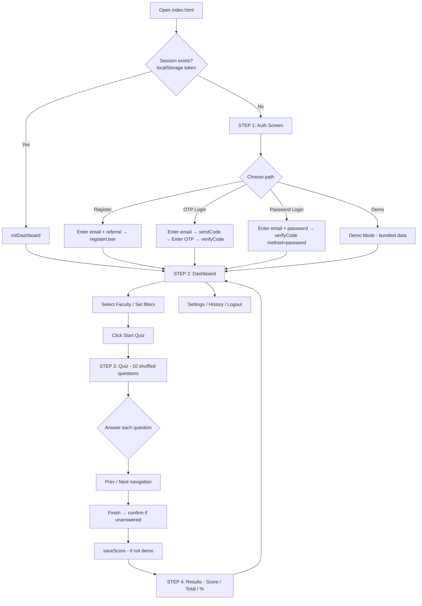

# Standard Operating Procedure (SOP)
## MCQ Master — CPREC Nepal
### User Workflow: Authentication → Dashboard → Quiz → Results

| Field | Detail |
|---|---|
| **System** | MCQ Master \| CPREC Nepal (`index.html` + `Code.gs`) |
| **Document Title** | SOP for End-User Workflow |
| **Version** | 3.0 |
| **Effective Date** | 27 November 2026 |
| **Owner** | CPREC Nepal |
| **Applies To** | Students, Faculty, and Administrators using the MCQ Master web application |
| **Backend** | Google Apps Script Web App — `Code.gs` (`doGet`/`doPost` → `handleRequest`) |
| **Frontend** | Single-page application — `index.html` (HTML + Tailwind CSS + Vanilla JS) — includes Admin UI (SOP-14–16) |
| **Data Store** | Google Sheets (9 sheets) + Google Drive (avatar folder) + GmailApp (OTP/approval emails) |

---

## 1. Purpose

This SOP defines the standard, step-by-step procedure for completing the core workflow in MCQ Master:

> **Authenticate → Configure Quiz → Attempt Quiz → View Results → Manage Profile**

It ensures consistent, error-free use by students and support staff, and provides a single reference for training, onboarding, and troubleshooting.

## 2. Scope

**In scope:**
- User registration (request → admin approval → credentials email), login (OTP & password), and demo access
- Dashboard navigation (Overview / Settings / History)
- Quiz setup with Faculty and Set filters
- Quiz attempt, navigation, scoring, and result submission
- Profile update, avatar upload (Google Drive), password change, and referral sharing
- Admin workflow: pending approvals, user management, MCQ management, blocking / force-logout
- Backend deployment and sheet maintenance (`Code.gs`)

**Out of scope:**
- Google account / Workspace administration
- Server hosting beyond Google Apps Script

## 3. Roles & Responsibilities

| Role | Responsibilities |
|---|---|
| **Student / User** | Register (request access), login, attempt quizzes, maintain own profile, share referral code |
| **Faculty / Trainer** | Guide students through SOP; verify quiz results in History |
| **Administrator** | Approve/reject pending users, manage users (block / force-logout), add/delete MCQs, resolve access issues |
| **Super Admin** | Create other admins (`addAdminUser`); hardcoded in `isSuperAdmin()` in `Code.gs` — only these emails can add admins |

## 4. System Overview

```
┌──────────────┐    HTTPS GET (query params)    ┌─────────────────────────┐
│  index.html  │ ─────────────────────────────▶ │ Google Apps Script API  │
│  (Frontend)  │ ◀───────────────────────────── │ Code.gs: doGet/doPost   │
└──────┬───────┘                                │ → handleRequest()       │
       │ localStorage: mcq_token, mcq_email     └───────────┬─────────────┘
       ▼                                                    │
┌──────────────┐                              ┌─────────────┼─────────────┐
│  Browser     │                              ▼             ▼             ▼
└──────────────┘                        Google Sheets   Google Drive   GmailApp
  Demo fallback: bundled DEMO data      (9 sheets)      (avatars)      (OTP / approval)
  (12 sample MCQs)                      SS_ID in Code.gs
```

**Key facts:**
- No build step. Open `index.html` in any modern browser.
- Session persists via `localStorage` (`mcq_token`, `mcq_email`) until Logout.
- If the backend is unreachable, the app falls back to bundled demo questions and notifies the user via toast.
- All API calls are `GET` requests with query parameters (`type=...`).

### 4.1 API Reference (Backend Contract)

| `type` Parameter | Purpose | Key Parameters | Auth |
|---|---|---|---|
| `registerUser` | **Request** account (→ PendingRequests, admin approval required) | `email`, `referralCode`, `ip` | No |
| `sendCode` | Send OTP to email (60s throttle) | `email`, `ip` | No |
| `verifyCode` | Verify OTP **or** password login → returns `token`, `role` | `email`, `code`, `method=password` (optional) | No |
| `getProfile` | Fetch user profile | `email`, `token` | Token |
| `getMCQs` | Fetch question bank | — | No |
| `getFilters` | Fetch Faculty (`subjects`) / Set (`colleges`) lists | — | No |
| `uploadAvatar` | Upload photo to Drive, returns URL | `email`, `token`, `base64Data`, `mimeType` | Token |
| `updateProfile` | Save profile / password | `email`, `token`, `fullName`, `phone`, `college`, `newPassword` | Token |
| `applyReferral` | Credit referrer (wired in Settings → Apply Referral) | `email`, `token`, `code` | Token |
| `getHistory` | Fetch own quiz history (newest first) | `email`, `token` | Token |
| `saveScore` | Persist quiz result → QuizHistory | `email`, `subject`, `college`, `score`, `total`, `percentage` | No |
| `getPendingUsers` | List Pending requests | `email`, `token` | **Admin** |
| `approveUser` | Approve user, generate password+code, email credentials | `email`, `token`, `targetEmail` | **Admin** |
| `getUsers` | List all users (status, online, role, avatar) | `email`, `token` | **Admin** |
| `toggleBlock` | Block / unblock user | `email`, `token`, `targetEmail` | **Admin** |
| `forceLogout` | Clear user's token (kick session) | `email`, `token`, `targetEmail` | **Admin** |
| `addMCQ` | Add question to MCQs sheet | `email`, `token`, `subject`, `college`, `qnumber`, `question`, `optionA-D`, `answer`, … | **Admin** |
| `deleteMCQ` | Delete question by `qnumber` | `email`, `token`, `qnumber` | **Admin** |
| `addAdminUser` | Create new admin (both sheets) | `email`, `token`, `newEmail`, `fullName`, `role`, `password` | **Super Admin only** |

---

## 5. Prerequisites

1. Modern browser (Chrome / Edge / Firefox / Safari) with JavaScript enabled.
2. Internet connection (required for live login and question loading; demo mode works offline after page load).
3. Valid email address for registration / OTP login.
4. (Optional) Referral code from an existing user for registration credit.

---

## 6. Workflow Overview



**Screen / Step Map (in code):**

| Step ID | Section ID | Description |
|---|---|---|
| Step 1 | `step-auth` | Login / Register / Demo |
| Step 2 | `step-dashboard` | Overview, Settings, History panels |
| Step 3 | `step-quiz` | Question-by-question attempt |
| Step 4 | `step-results` | Final score display |

---

## 7. Detailed Procedures

### SOP-01 — User Registration (Request → Admin Approval)

**When:** A new user needs an account. **Registration does NOT create an account instantly** — it creates a *pending request* that an Admin must approve (SOP-14).

1. On the Auth screen, click **“New user? Register”** (`btn-toggle-mode`).
   - Referral field appears; mode switches to `register`; method resets to OTP.
2. Enter a valid **email** in `auth-email` (must match `^[a-zA-Z0-9._%+-]+@[a-zA-Z0-9.-]+\.(com|org|edu|net|gov|np|org\.np)$`).
3. (Optional) Enter **Referral Code** in `auth-referral` — stored in PendingRequests Col F for later credit.
4. Click **“Request Access”** (`btn-auth-action`).
5. Backend `registerUser` checks:
   - Email not already in `EmailVerifications` → else “Email already registered.”
   - No existing non-approved pending row → else “Request already pending approval.”
   - Appends row to `PendingRequests`: `[Date, Email, IP, Location, "Pending", ReferralCode]`.
6. Observe toast: “Request sent to Admin. Please wait for approval email.”
7. **Wait for approval email** from `no-reply@mcqs.cprecnepal.org.np` containing generated password + temporary code (sent by Admin via SOP-14).
8. After approval, log in using SOP-02 (OTP) or SOP-03 (password from approval email).

> **Note:** Registration does not auto-login. Always complete a login step after registering.

---

### SOP-02 — Login via OTP (Email Code)

**When:** Default login method. No password required.

1. Ensure mode is **Login** and method is **OTP** (button reads “Continue with Email”).
   - If not, click **“Login with Password”** toggle to switch back to OTP.
2. Enter **email** → click **“Continue with Email”**.
3. System calls `sendCode`. On success:
   - OTP modal (`modal-back`) opens.
   - Toast: “Code sent to your email”.
4. Enter the **6-digit code** in `input-otp` → click **Verify** (`btn-verify-otp`).
5. System calls `verifyCode` with `email` + `code`.
6. On success:
   - Token saved to `localStorage` (`mcq_token`, `mcq_email`).
   - `initDashboard()` loads profile + questions.
   - Toast: “Welcome back!”
7. On failure: toast shows backend message (e.g., expired/invalid code). Re-request a new code from Step 2.

---

### SOP-03 — Login via Password

**When:** User has an existing password set via Profile Settings.

1. On Auth screen, click **“Login with Password”** (`btn-toggle-method`).
   - Password field (`auth-password-group`) appears; button text changes to “Login”.
2. Enter **email** and **password**.
3. Click **Login**.
4. System calls `verifyCode` with `method=password`.
5. On success: token stored, dashboard loads (same as SOP-02, Step 6).
6. On failure: toast shows error. Verify password or switch to OTP login.

---

### SOP-04 — Demo Mode (No Account Required)

**When:** Training, evaluation, or backend is unavailable.

1. On Auth screen, click **“Try Demo Mode”** (`btn-demo`).
2. System sets `state.demo = true`, loads bundled `DEMO` profile and 12 sample MCQs (Pharmacy / Nursing / Public Health / Biology).
3. Dashboard loads immediately; toast: “Demo mode — sample questions loaded”.
4. **Important:** In demo mode:
   - No backend calls are made for profile/questions.
   - Scores are **not** saved (`saveScore` is skipped).
   - Use only for practice and demonstration.

---

### SOP-05 — Dashboard Navigation

After successful login, the Dashboard (`step-dashboard`) is displayed.

1. **Sidebar panels** (click to switch):
   - **Dashboard / Overview** (`panel-overview`) — Stats: Quizzes taken, Average Score, Referrals.
   - **Settings** (`panel-settings`) — Profile & referral management (SOP-09, SOP-10).
   - **History** (`panel-history`) — Past attempts (SOP-11).
2. **Header:** User badge (avatar + name) — click to jump to Settings. App is light-mode only (no theme toggle).
3. **Quiz Setup** section is always visible in the sidebar (SOP-06).

---

### SOP-06 — Quiz Setup & Filtering

**When:** Preparing to start a quiz.

1. In the sidebar **Quiz Setup** section:
   - **Faculty** (`filter-faculty`) — Select a subject (e.g., Pharmacy, Nursing) or leave “All Faculties”.
   - **Set** (`filter-level`) — Select a level/set (e.g., Set 1, Set 2) or leave “All Sets”.
2. Filters are populated from:
   - Live backend via `getFilters`, **or**
   - Derived locally from loaded questions (`populateFilters()`) if backend is unavailable.
3. If a filter is active, **Reset** button appears — click to clear both filters.
4. Click **Start Quiz** (`btn-start-quiz`).
   - System filters questions, applies **Fisher-Yates shuffle**, and selects up to **10 questions**.
   - If no questions match: toast “No questions found” — change filters and retry.

> **Rule:** The Set filter is applied when questions carry a `level` field (demo data) **or** a `college` field (live backend, e.g. NPC), so both demo and live sets filter correctly.

---

### SOP-07 — Taking a Quiz

**Screen:** `step-quiz`

1. **Question display:** Counter (“Question X of Y”), progress bar, and “X/Y answered” indicator.
2. **Answering:**
   - Click an option card (A / B / C / D).
   - Correct answer turns **green**; wrong selection turns **red** with correct answer highlighted.
   - Answer is locked for that question (cannot change after selection).
   - Score increments immediately if correct.
3. **Navigation:**
   - **Prev** — Go to previous question (disabled on Question 1).
   - **Next** — Go to next question. Enabled only after answering current question; disabled on last question.
   - **Finish** — End quiz at any time (see SOP-08).
4. Repeat until all questions are answered or you choose to finish early.

---

### SOP-08 — Finishing & Viewing Results

1. Click **Finish** (`btn-q-finish`).
2. If not all questions answered:
   - Confirmation dialog: “You've answered X of Y questions. Finish anyway?”
   - Click **OK** to submit, **Cancel** to continue.
3. System calculates: `Score`, `Total`, `Percentage = (Score/Total) × 100`.
4. If **not** in demo mode: calls `saveScore` with email, subject (selected Faculty or “General”), score, total, percentage.
5. **Results screen** (`step-results`) displays: `Score/Total (Percentage%)`.
6. Click **“Back to Dashboard”** to return to Overview and start another quiz.

---

### SOP-09 — Profile & Settings Update

**Screen:** `panel-settings`

1. Click **Settings** in sidebar (or user badge in header).
2. **Avatar:**
   - Click camera icon → select image file (`avatar-upload`).
   - File is read as Base64 and sent via `uploadAvatar`.
   - On success: avatar updates in header and settings; toast “Photo updated!”.
3. **Edit fields:**
   - Full Name (`settings-name`)
   - Phone (`settings-phone`, e.g., +977...)
   - College/Organization (`settings-college`)
   - Email (`settings-email`) — **read-only**, cannot be changed here.
4. **Password (optional):** Enter new password in `pass-new` to set/change it.
5. Click **Save Changes** (`btn-save-profile`).
   - System calls `updateProfile`.
   - On success: UI refreshes, password field clears, toast “Profile saved!”.
   - On failure: toast shows error; correct and retry.

---

### SOP-10 — Referral Code Sharing

1. In Settings, scroll to **Referral Section**.
2. Your code is shown in `referral-code-display`.
3. Click **Copy** icon (`copyReferral()`) — code copied to clipboard; toast “Code copied!”.
4. Share the code with friends. When they register with your code (SOP-01), you earn referral credit (tracked in Overview → Referrals).

---

### SOP-11 — History Review

1. Click **History** in sidebar.
2. Panel (`panel-history`) lists past quiz attempts (loaded from backend profile/history data).
3. If empty: “No history found.”
4. Use History to review performance before attempting new quizzes.

---

### SOP-12 — Logout & Session Management

1. Click **Logout** (`btn-logout`) in sidebar.
2. System clears `localStorage` and reloads the page (`location.reload()`).
3. User returns to Auth screen; token is removed.
4. **Auto-login:** On page load, if `mcq_token` + `mcq_email` exist in `localStorage`, the app skips Auth and goes directly to Dashboard (`initDashboard()`).

> **Security note:** Always logout on shared/public computers. Tokens are stored in browser local storage — do not share devices without logging out.

---

### SOP-13 — Theme (Light Only)

- The app is **light mode only**. The dark/light toggle has been removed.
- `<body class="light-mode">` is hardcoded in `index.html`; no user action can switch themes.
- To re-enable dark mode in future, restore the `theme-toggle` button + JS handler (see git history).

---

## 7A. Backend & Admin Procedures (Code.gs)

> Admin UI is built into `index.html` (sidebar → **Admin**, visible only when `role === 'Admin'`).
> All admin calls require a valid Admin `token` (checked by `isAdmin()` against `AdminSettings` + `EmailVerifications`).
> Role is returned by `verifyCode`, stored in `localStorage` (`mcq_role`), and restored on auto-login.

### SOP-14 — Admin: Review & Approve Pending Users

**When:** New registration requests arrive in `PendingRequests`.

1. Call `getPendingUsers` with Admin `email` + `token`.
   - Returns all rows where Status = `Pending` (`date`, `email`, `ip`, `location`).
2. Verify the request (email domain, IP/location if needed). Reject by leaving Status as-is or manually editing the sheet.
3. To approve, call `approveUser` with `email`, `token`, `targetEmail`.
   - Backend verifies a `Pending` row exists and user does not already exist in `EmailVerifications`.
   - Generates: 6-digit `code`, 8-char `password` (`generatePassword()`), referral code (`generateReferralCode()`).
   - Appends user to `EmailVerifications` (20-col standard row, Role=`User`, Status=`Pending`).
   - Sets Pending row Status → `Approved`.
   - Emails credentials via `GmailApp.sendEmail` from `no-reply@mcqs.cprecnepal.org.np` (subject: “Account Approved - CPREC Nepal”).
4. User receives password + temporary code and logs in via SOP-02 / SOP-03.
5. On success toast: “User approved and credentials sent.”

### SOP-15 — Admin: User Management

| Action | Endpoint | Effect |
|---|---|---|
| List users | `getUsers` | Returns email, status, blocked flag, login count, Online/Offline, activity, role, avatar |
| Block / Unblock | `toggleBlock` | Toggles `EmailVerifications` Col G between `Blocked` and empty. Blocked users cannot `sendCode` or `verifyCode`. |
| Force logout | `forceLogout` | Clears Token (Col E) and sets Online=`No`. User must re-login. |
| Create admin | `addAdminUser` | **Super Admin only** (`isSuperAdmin()`). Appends to both `AdminSettings` and `EmailVerifications`. |

**Procedure:** Authenticate as Admin → call endpoint with `email`, `token`, `targetEmail` → verify toast / sheet change.

### SOP-16 — Admin: MCQ Management

1. **Add:** Call `addMCQ` with Admin credentials + `subject`, `college` (= Set), `qnumber`, `question`, `optionA–D`, `answer` (A/B/C/D), optional `image`, `explanation`, `correctText`, `fbA–D`.
   - Appends 16-col row to `MCQs` sheet.
2. **Delete:** Call `deleteMCQ` with `qnumber`.
   - Deletes first matching row in `MCQs`.
3. Verify via `getMCQs` / `getFilters` that the question and its Faculty/Set appear.

> **Sheet mapping (MCQs):** Col A=Subject/Faculty, B=College/Set, C=QNumber/ID, D=Question, E–H=Options A–D, I=Answer, J=Image, K=Explanation, L=CorrectText, M–P=Feedback A–D.
> Frontend “Set” filter maps to `college` (Col B) in live mode; demo data uses `level`.

### SOP-17 — Backend Deployment (Google Apps Script)

1. Open the Apps Script project linked to the spreadsheet (`SS_ID` in `Code.gs`).
2. Replace `Code.gs` content with the repo version (`Code.gs` in this repository). ⚠️ Do **not** redeploy an older copy — it silently loses `getHistory`, referral auto-credit, and pending-aware `sendCode`.
3. **Deploy → Manage deployments → Edit → New version** (do NOT create a new deployment if you want to keep the same `/exec` URL used in `index.html` → `const API`).
4. Set: *Execute as: Me*, *Who has access: Anyone*.
5. Authorize scopes on first run (Sheets, Drive, Gmail).
6. Test: open `…/exec?type=getFilters` in browser → expect `{"success":true,"subjects":[…],"colleges":[…]}`. Also test `…/exec?type=getMCQs` → expect the question list.
7. Update `const API` in `index.html` only if the deployment URL changes.

**App not loading after deployment — checklist (in order of likelihood):**

| # | Cause | Symptom | Fix |
|---|---|---|---|
| 1 | Created a **new deployment** (new URL) | Every request fails; toasts "Network Error" / "Couldn't load questions" | Use *Manage deployments → Edit → New version* to keep the URL, **or** update `const API` in `index.html` to the new `/exec` URL |
| 2 | *Who has access* ≠ **Anyone** | Browser test URL shows a Google sign-in page, not JSON | Redeploy with *Who has access: Anyone* |
| 3 | *Execute as* ≠ **Me** | Visitors asked to authorize / get error page | Redeploy with *Execute as: Me* |
| 4 | New code **not published as a new version** | `/exec` still serves old code | *Manage deployments → Edit → Version: New version → Deploy* |
| 5 | Not **re-authorized** after pasting new code | Error page at `/exec` | Run any function in the editor once → complete *Review permissions* |
| 6 | Spreadsheet **missing sheets** (`MCQs`, `EmailVerifications`, `CodeBackups`, `UserActivity`) | Every request returns `{success:false, error: TypeError…}` | Use repo `Code.gs` — it auto-creates all 9 sheets with headers |
| 7 | `MCQs` sheet **empty** | No live questions (bundled NPC set still works after merge of the instant-load PR) | Load the bank: SOP-23 (paste `mcqs-npc.csv` into the MCQs sheet) |
| 8 | Frontend copy is **outdated** | No NPC bundle / old API URL / old cache behavior | Serve the latest `index.html` **and** `mcqs-npc-data.js` from the repo root together |
| 9 | Gmail alias not configured | `sendCode` returns "Email failed to send." | Configure `no-reply@mcqs.cprecnepal.org.np` as a *Send mail as* alias on the deploying Google account, or change the sender in `Code.gs` |

**60-second isolation test:** open `…/exec?type=getFilters` in a browser.
- **JSON appears** → backend is fine; the problem is the frontend (`const API` URL mismatch, outdated `index.html`, or the app hosted without `mcqs-npc-data.js`).
- **Sign-in page / error page /Apps Script error** → backend deployment settings (rows 2–5) or spreadsheet (row 6).

### SOP-18 — Avatar Upload (Drive)

1. User selects image in Settings (SOP-09) → frontend sends Base64 via `uploadAvatar`.
2. Backend decodes Base64 → creates Blob → saves to Drive folder (`DRIVE_FOLDER_ID`) as `NAME_Email_Photo`.
3. Sets sharing to *Anyone with link (View)* → returns `https://drive.google.com/uc?export=view&id=FILE_ID`.
4. URL stored in `EmailVerifications` Col P (Index 15) and returned to frontend.

### SOP-19 — Referral Credit

1. Referral code is auto-generated per user (`NAME + 4-digit`, e.g., `MANI1234`) and stored in `EmailVerifications` Col S.
2. Registration stores the used code in `PendingRequests` Col F.
3. **Auto-credit on approval:** `approveUser` reads the referral code from the pending row and credits the referrer (logs to `Referrals`, increments Col T).
4. **Manual apply:** Logged-in users can enter a code in Settings → *Apply a Referral Code* → `applyReferral` validates, logs, increments, rejects self-referral.
5. Frontend copy/share flow is SOP-10; Overview → Referrals shows live `referralsCount` from `getProfile`.

### SOP-20 — Security & Locking Rules

- Every request runs under `LockService.getScriptLock().tryLock(10000)` — concurrent writes are serialized; do not remove.
- Token validation: `getProfile` / `updateProfile` / `uploadAvatar` compare sheet Token (Col E) to supplied `token`.
- Blocked accounts (`Blocked` in Col G) are rejected at `sendCode` and `verifyCode`.
- OTP throttle: `sendCode` enforces 60-second gap using last-sent Date (Col D).
- Passwords are stored in plain text in Sheets (Col O / AdminSettings Col F) — **restrict spreadsheet sharing to Admins only**; never share the sheet publicly.
- `isSuperAdmin()` is hardcoded — to add a Super Admin, edit `Code.gs` and redeploy (SOP-17).


### SOP-21 — Admin UI Walkthrough (Frontend)

**When:** Logged in as Admin (`role === 'Admin'`).

1. Sidebar shows **Admin** button with pending-count badge. Click to open `panel-admin`.
2. **Pending Approvals:** list from `getPendingUsers`. Click **Approve** per user → confirm → `approveUser` → credentials emailed. List refreshes automatically.
3. **Users:** list from `getUsers` (avatar, role, online status, logins). Per user:
   - **Block / Unblock** → `toggleBlock`
   - **Force Logout** → `forceLogout` (confirm first)
4. **Add MCQ:** fill Subject, College/Set, Q Number, Question, Options A–D, Answer, optional Image/Explanation/CorrectText/Feedback → **Add MCQ** → `addMCQ`. Form clears and quiz filters refresh.
5. **Delete MCQ:** enter Q Number → **Delete** → confirm → `deleteMCQ`.
6. **Create Admin (Super Admin only):** visible only if your email is in `SUPER_ADMINS` (mirrors `isSuperAdmin()` in `Code.gs`). Enter email, name, role, password → **Create Admin** → `addAdminUser`. Backend rejects non-Super-Admins regardless of UI visibility.
7. **Refresh All** reloads pending + users.

### SOP-22 — History & Dashboard Stats (Live)

1. On login, frontend calls `getHistory` (token-validated, own rows only, newest first) and renders:
   - **Overview:** Quizzes = history count, Avg Score = mean of `percentage`, Referrals = `referralsCount` from `getProfile`.
   - **History panel:** each attempt shows Subject, Date, College/Set, `Score/Total (Percentage%)`.
2. **Refresh** button in History reloads via `getHistory`.
3. Demo mode: history is empty; stats show 0.

### SOP-23 — Admin: Load the NPC Question Bank (Pharmacy / NPC)

**One-time setup** so candidates can take exams from the 100-question NPC bank (repo files `mcqs-npc.json` / `mcqs-npc.csv`, added in PR #12).

1. Open `mcqs-npc.csv` on GitHub → click **Raw** → **Select All → Copy** (or download the file).
2. Open the backend spreadsheet (`SS_ID` in `Code.gs`) → **MCQs** sheet.
3. Paste starting at **row 2, columns A–P** (Subject, College, QNumber, Question, OptionA–D, Answer, Image, Explanation, CorrectText, FeedbackA–D). Do not overwrite the header row.
4. Verify the paste: 101 rows total (header + 100), Subject = `Pharmacy`, College = `NPC`, QNumber 1–100, Answer ∈ {A, B, C, D}.
5. Verify in the app: reload Dashboard → Faculty dropdown shows **Pharmacy**, Set dropdown shows **NPC**; Start Quiz with Faculty = Pharmacy, Set = NPC returns questions.
6. **Answer key caution:** the source PDF has explanations but no key; answers were inferred (see `mcqs-npc-README.md`). Spot-check before publishing — especially questions listed in the README as inferred without an explanation.
7. Alternative for single questions: Admin UI → Add MCQ (SOP-16 / SOP-21). Bulk endpoint is a future enhancement.

> **Rule:** Never edit `Answer`/`CorrectText` directly in the app for the NPC set without also updating the repo JSON/CSV — GitHub is the source of truth for this bank.

### SOP-24 — Candidate: Taking an Exam from the NPC Bank (Pharmacy / NPC)

**When:** Sitting a practice exam from the NPC question collection.

1. **Login** (SOP-02 OTP / SOP-03 password; demo mode does **not** contain NPC questions).
2. On the Dashboard, in **Quiz Setup**:
   - **Faculty** → select `Pharmacy`.
   - **Set** → select `NPC`.
   - Click **Reset** first if filters were left over from a previous session.
3. Click **Start Quiz**. The system takes all Pharmacy/NPC questions, **Fisher-Yates shuffles** them, and serves **10 questions per attempt** (the bank has 100, so repeated attempts draw different questions). The NPC model set is **bundled with the app** (`mcqs-npc-data.js`) and cached locally, so it is quiz-ready **instantly** — no wait for the backend.
4. **Answer each question** (SOP-07): click an option card — correct turns green, wrong turns red with the correct answer highlighted; the answer locks. Use **Prev/Next** to navigate; there is **no time limit**.
5. **Finish** (SOP-08): confirm if questions remain unanswered. Score is saved via `saveScore` with Subject = `Pharmacy` and appears on the Results screen as `X/10 (Z%)`.
6. **Review:** the attempt appears in **History** (Subject Pharmacy, Set/College shown, score, date). Each row's percentage feeds the Overview average.
7. **Repeat:** return to Dashboard and Start Quiz again for a fresh random 10 questions from the bank.
8. If **“No questions found”** appears: the NPC bank has not been loaded into the MCQs sheet yet — admin must complete SOP-23 first.

---

## 8. End-to-End Workflow Checklist (Quick Reference)

| # | Action | Screen | Success Indicator |
|---|---|---|---|
| 1 | Open app | Auth | Welcome screen visible |
| 2 | Register (if new) → Admin approves (SOP-14) | Auth → Email | “Request sent to Admin” → approval email with password+code |
| 3 | Login (OTP/Password/Demo) | Auth → Dashboard | “Welcome back!” / Dashboard loads |
| 4 | Select Faculty/Set | Dashboard sidebar | Filters selected; Start Quiz enabled |
| 5 | Start Quiz | Quiz | Question 1 displayed; progress bar at 10% |
| 6 | Answer all questions | Quiz | Green/red feedback; X/Y answered updates |
| 7 | Finish Quiz | Quiz → Results | Score shown as `X/Y (Z%)` |
| 8 | Review History (optional) | Dashboard → History | Past attempts listed |
| 9 | Update Profile (optional) | Dashboard → Settings | “Profile saved!” toast |
| 10 | Logout | Sidebar | Returns to Auth screen |

**NPC exam quick path (SOP-23/24):** Admin pastes `mcqs-npc.csv` into MCQs sheet → candidate logs in → Faculty `Pharmacy` + Set `NPC` → Start Quiz → 10 random NPC questions → Finish → Score in History.

---

## 9. Troubleshooting

| Problem | Likely Cause | Action |
|---|---|---|
| “Email required” / “Password required” | Empty field | Enter required field and retry |
| “Code sent” but no email received | Spam / delay / wrong email | Check spam folder; re-request code; verify email spelling |
| OTP verification fails | Expired / incorrect code | Request a fresh code (SOP-02, Step 2) |
| “Couldn't load questions — using sample set” | Backend unreachable | Check internet; app auto-falls back to demo questions — retry later for live set |
| “No questions found” on Start Quiz | Filters too narrow | Clear Faculty/Set filters or click Reset |
| Next button disabled | Current question unanswered | Select an option first |
| Finish asks for confirmation | Unanswered questions remain | Answer remaining or confirm to submit partial attempt |
| Profile save fails | Network / invalid token | Check connection; re-login if session expired |
| Avatar upload fails | File too large / unsupported type | Use JPG/PNG; try a smaller image |
| Stuck on Auth after login | Token not saved | Clear cache, re-login; check browser allows localStorage |
| Scores not appearing in History | Demo mode or saveScore failure | Use live login (not demo); check backend logs |
| “No questions found” with Faculty=Pharmacy, Set=NPC | NPC bank not loaded yet | Admin: complete SOP-23 (paste `mcqs-npc.csv` into MCQs sheet) |
| Set filter (NPC) does not narrow questions | Old cached question data (pre-fix) | Refresh page / clear 5-min cache; the Set filter now matches `college` too |
| Duplicate NPC questions after re-paste | CSV pasted twice | Delete duplicate rows (QNumber 1–100 per NPC) or clear and re-paste |

---

## 10. Compliance & Quality Checks

- [ ] User is authenticated before accessing Dashboard/Quiz.
- [ ] Quiz questions are shuffled (Fisher-Yates) — no fixed order.
- [ ] Answers are locked after selection; correct/wrong feedback is immediate.
- [ ] Score is calculated as `correct / total` and saved only in live mode.
- [ ] Email field in Settings is read-only.
- [ ] Logout clears session token.
- [ ] Demo mode never writes to backend.

---

## 11. Appendix — File & State Reference

**Files:** `index.html` + `tailwind.css` (pre-compiled) + `logo.png` (256px optimized) + `mcqs-npc-data.js` (bundled NPC model set, auto-generated from `mcqs-npc.json`)
**Tailwind rebuild (after editing classes in `index.html`):** `npx tailwindcss -i input.css -o tailwind.css --minify` (config in `tailwind.config.js`)
**Performance (instant load):**
1. **Bundled model exam set** — `mcqs-npc-data.js` (Pharmacy/NPC, 100 MCQs) ships with the page; the quiz is startable before any backend call.
2. **Pre-auth prefetch** — `getMCQs` + `getFilters` are fetched while the user is still on the login screen (public endpoints).
3. **Stale-while-revalidate cache** — `localStorage` (`mcq_cache_mcqs`/`mcq_cache_filters`) seeds the dashboard instantly (24 h "fresh" window; stale data still renders, then revalidates). Dashboard loads profile/MCQs/filters/history in parallel (`Promise.all`).
4. **Merge rule** — backend questions override the bundle by key `subject|college|qnumber`; the bundle fills gaps and keeps the set available when the backend is slow/offline. Prefetch promises are consumed once, so Add/Delete MCQ always triggers a fresh fetch.
5. **Regenerating the bundle:** after editing `mcqs-npc.json`, rebuild `mcqs-npc-data.js` with the same entry shape (`{ q, options[4], answer, subject, college, qnumber, explanation }`) — `window.NPC_MCQS = [...]`.

**Global State (`state` object):**
```js
{
  mode: 'login' | 'register',
  method: 'otp' | 'password',
  email: string,
  token: string,
  demo: boolean,
  profile: { email, fullName, phone, college, avatar, referralCode },
  mcqs: Array<{ q, options[4], answer: 'A'|'B'|'C'|'D', subject, level }>,
  quiz: { index, data[], answers{}, score }
}
```

**Demo Data:** 12 bundled MCQs across Pharmacy, Nursing, Public Health, Biology (Sets 1–3).

**Toast Notifications:** Used for all success/error feedback (top-right, auto-dismiss 4s).

---


### Appendix B — Google Sheets Schema (Code.gs)

| Sheet | Purpose | Key Columns |
|---|---|---|
| `EmailVerifications` | User accounts (source of truth) | A:Email, B:Code, C:Status, D:Date, E:Token, F:LoginCount, G:Blocked, H:Online, I:Activity, J:Role, K:FullName, L:LoginTime, M:LastActive, N:Duration, O:Password, P:Avatar, Q:Phone, R:College, S:RefCode, T:RefCount |
| `MCQs` | Question bank | A:Subject, B:College/Set, C:QNumber, D:Question, E–H:Options, I:Answer, J:Image, K:Explanation, L:CorrectText, M–P:Feedback |
| `PendingRequests` | Registration queue | A:Date, B:Email, C:IP, D:Location, E:Status, F:ReferralCode |
| `AdminSettings` | Admin accounts | A:Email, B:FullName, C:Status, D:Role, E:Token, F:Password, G:CreatedOn |
| `QuizHistory` | Score log | A:Date, B:Email, C:Subject, D:College, E:Score, F:Total, G:Percentage |
| `Referrals` | Referral log | A:Date, B:Referrer, C:ReferredEmail, D:Status |
| `CodeBackups` | OTP audit backup | A:Email, B:Code, C:Date, D:—, E:IP, F:Location |
| `DeniedLogins` | Failed / unregistered attempts | A:Date, B:IP, C:Location, D:Reason |
| `UserActivity` | Login activity log | A:Date, B:Email, C:Action, D:IP, E:Location, F:Token |

**Config in `Code.gs`:** `SS_ID` (Spreadsheet ID), `DRIVE_FOLDER_ID` (Avatar folder), sender `no-reply@mcqs.cprecnepal.org.np`, Super Admins in `isSuperAdmin()`.

## 12. Revision History

| Version | Date | Author | Change |
|---|---|---|---|
| 1.0 | 2026-11-27 | CPREC Nepal | Initial SOP based on `index.html` workflow |
| 2.0 | 2026-11-27 | CPREC Nepal | Added backend (`Code.gs`): admin approval flow, user/MCQ management, Drive avatars, referrals, sheet schema, deployment SOP |
| 3.0 | 2026-11-27 | CPREC Nepal | Added Admin UI + referral/history wiring in `index.html`; backend: `getHistory`, referral auto-credit on approval, pending-aware `sendCode` |
| 3.1 | 2026-11-27 | CPREC Nepal | Added SOP-23 (admin: load NPC bank from GitHub) and SOP-24 (candidate: take NPC exam); Set filter now matches `college` (live) as well as `level` (demo); NPC troubleshooting rows |
| 3.2 | 2026-11-27 | CPREC Nepal | Instant model-exam load: bundled `mcqs-npc-data.js` (Pharmacy/NPC), pre-auth prefetch of public MCQs/filters, stale-while-revalidate localStorage cache (24 h fresh window), backend-over-bundle merge; SOP-24 + Appendix updated |
| 3.3 | 2026-11-27 | CPREC Nepal | Deployment hardening: `Code.gs` auto-creates all 9 sheets incl. headers (fresh-spreadsheet TypeError fix); SOP-17 "app not loading" checklist + 60-second isolation test |

---

*For backend or question-bank issues, contact the CPREC Nepal administrator. For user-facing issues, follow Section 9 (Troubleshooting) first.*
